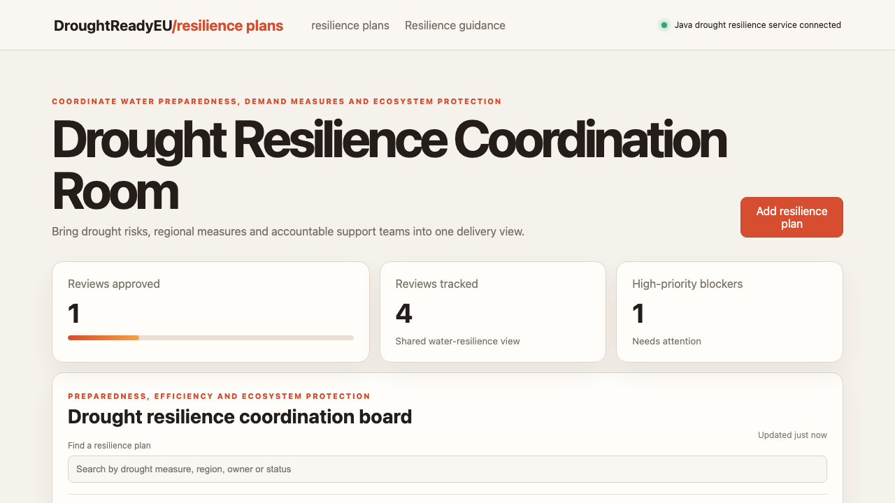

# Drought Resilience Coordination Room

## One-sentence benefit
Helps water authorities coordinate drought indicators, efficiency measures and accountable regional response.

## Live demo
Run the Java service and Angular application locally to use the complete experience.

## Screenshots

## Main features
Search resilience plans, create a regional measure, progress safeguards and monitor approval and high-priority risks.

## Technology used
Angular, TypeScript, signals, computed state, server rendering, Spring Boot and Java.

## Installation instructions
Start the backend with `cd backend && mvn spring-boot:run`. In another terminal run `npm install && npm start`.

## Commercial licensing/contact
Commercial licensing and implementation support are available through the repository owner.

## Business problem and users
Water authorities, municipalities, utilities and sector coordinators need shared evidence for scarcity risks and response measures.

## Key workflows
Teams can find a resilience plan, add a validated drought measure and advance safeguards to approval.

## Angular framework highlights
The interface uses standalone components, signals, computed values, OnPush change detection, built-in control flow and SSR-safe loading.

## Java backend highlights
The Spring Boot service provides real list, search, create and update endpoints, validation, clear errors, health reporting and tests.

## Architecture and state flow
Angular HttpClient connects signal-based state to the Java API and updates the visible board after every write.

## Accessibility and responsive behaviour
Semantic structure, labelled controls, visible focus, high contrast and compact responsive tables support varied users and devices.

## Verification commands
Use `npm test -- --watch=false`, `npm run build`, and `cd backend && mvn test package`.

## Structure
`src` contains the Angular experience, `backend` contains the Java service, and `docs` contains verified media.

## Tradeoffs
Records are held in memory for demonstration speed; operational use would add identity, durable storage and river-basin data integrations.

## Roadmap
Add Copernicus indicators, reservoir and demand data, authority sign-off, multilingual notices and audit-ready persistence.
